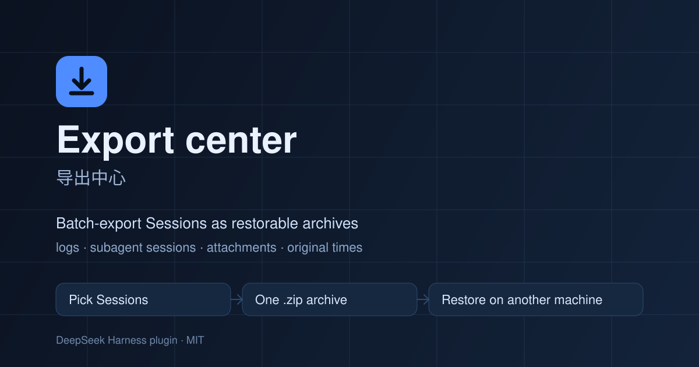

# Export center

Two independent blocks on one page. The plugin inventory moves how a machine's
bundles are installed; the Session block moves conversations.

## Session archives (export)

1. Search or filter by date, tick the Sessions, press **Export sessions**.
2. Each ticked Session is read through the official `api/session.export` route —
   the same archive the Session header's download action produces. It contains
   the canonical `session.v4.jsonl` log, the logs of its subagent children under
   `subagents/<id>/`, and every referenced attachment (`media/…` for images,
   `files/…` for generic files).
3. The browser wraps those archives in one container ZIP with a
   `manifest.json`, then downloads a single `dsh-sessions-<time>.zip`.

The archive budget is 200 MB of Session packages per export; a selection that
would exceed it stops at the budget and reports the Sessions it left out.

## Session archives (import)

1. **Import sessions** opens a file picker for the `.zip` written above.
2. The panel lists this machine's Workspaces next to the Import control and sends
   the chosen one; the Host prefers an explicit request, then a Workspace whose
   directory equals the source `cwd`, then the first registered Workspace. The
   report says which one was used and how it was chosen.
3. The browser uploads the container to `api/export-center.import`; the Host
   half does the writing:
   - every log becomes a new Session through `sessionPersistence`, keeping the
     original `createdAt` and the original event times, so imported Sessions
     sort at their original place in the list;
   - the Session's `cwd` becomes the chosen Workspace's path;
   - PNG, JPEG, WebP and GIF images are stored with `attachments.saveImage`;
     any other image format, and any image the store refuses, is saved verbatim
     through `attachments.saveFile` and listed as converted, so its bytes still
     travel with the Session;
   - subagent children keep their recorded `delegationDepth`, rewrite their
     parent link to the restored root, and lose an `agentPreset` this
     deployment does not compose (the report flags it);
   - an `agentPreset` the target does not know is dropped rather than written.
4. The panel reports each restored Session (title, cwd, event count, subagent
   count, attachment count), the target Workspace, and every entry that failed.
5. The panel probes `api/export-center.workspaces` on load. A 404 means the Host
   half is not loaded — for example after the browser half was hot-swapped
   without restarting DSH — and then a banner explains it and Import is
   disabled instead of failing later with a bare HTTP status.
6. Each archive carries an `archiveId` (the SHA-256 of the file). Importing the
   same archive again still restores another set of Sessions, but the report and
   the panel say it was imported before.

### Limitations

- A Session whose log needs a Session format newer than the running DSH cannot
  be restored; the entry is reported as failed instead of being skipped
  silently.
- Archive images larger than the deployment's image limits are reported as
  failed attachments; files are stored verbatim with no size normalization.
- Importing the same archive twice creates a second set of Sessions. The report
  and the panel flag a repeat (`duplicate: true`) but do not refuse it, and the
  memory of imported archives lasts only for the Host process.
- The import writes to the Workspace that matches the source `cwd`; a source
  directory that does not exist on this machine falls back to the first
  Workspace, and that fallback is drawn as a warning in the panel and recorded
  per restored Session.
- Only one import runs at a time: a second upload while one is running answers
  `409`. Both operations can be cancelled from the panel; a cancelled import
  keeps the Sessions it already wrote.
- Archive limits: 256 MB uploaded, 64 MB per produced entry, 512 MB inflated
  per archive, 500 Session logs, 200 000 events per log. Entries are read by
  `fflate` on a streaming basis; a CRC mismatch, a damaged central directory, or
  an over-limit entry fails only that package. Archives without a readable
  central directory are refused, so ZIP64 archives are not accepted.
- A Session whose log write fails after its header was stored is reported with
  its residual id. The persistence API offers no deletion, so the leftover must
  be removed by hand.
- Forked (`isSeeded`) sources are restored with `isSeeded: false`; the seed
  marker is replayed as ordinary history, so they read correctly but their
  resume behavior is not verified.

## Export language

The generated parts of an export — file name, the `README.md` inside the
archive, and the manifest `about` — use the active interface language
(`ctx.locale`, falling back to the browser language). The manifest records
`locale`, a timestamp with its UTC offset, and the IANA time zone. Session
content and titles are never translated.

The archive README states what exported what, when, from which environment, and
how to restore it.

## Plugin inventory

- **Export** writes a manifest v2: `name`, `version`, `spec`,
  `sourceKind` (`registry`, `git`, `link`, `file`, `catalog`, `unknown`), and
  `enabled`. Display metadata, icons, and local paths are not included.
- **Import** builds a plan per bundle: to install, present but to enable, same
  version, different version, ships with DSH, disabled on the source machine,
  or needs a manual copy (a `link:`/`file:` bundle has no registry spec). Each
  installable row shows the exact spec it will run and carries its own
  checkbox.
- A bundle that is installed but switched off is offered as **present, to
  enable** and enabled through `pluginManager.setBundleEnabled`.

## Requirements

The Session half needs the official Session-log export row
(`@deepseek-ai/dsh-session-log-export`), which the shipped Web bundle mounts. If
that row is disabled, Session reads answer `404 session not found` and the panel
reports it per Session.
