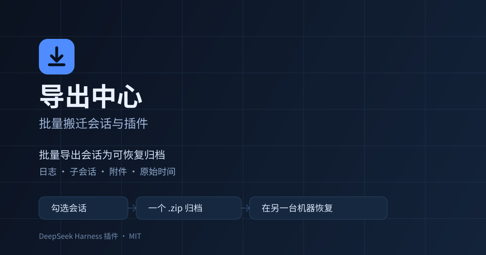

# 导出中心

一页两个独立区块。插件清单搬迁的是机器上安装的 bundle；会话区块搬迁的是对话。

## 会话归档（导出）

1. 搜索或按日期筛选，勾选会话，点 **导出会话**。
2. 每个勾选的会话都通过官方 `api/session.export` 路由读取——与会话标题栏下载动作产生的是同一个归档。归档包含规范的 `session.v4.jsonl` 日志、位于 `subagents/<id>/` 下的子会话日志，以及所有被引用的附件（图片在 `media/…`，普通文件在 `files/…`）。
3. 浏览器把这些归档包进一个带 `manifest.json` 的容器 ZIP，然后下载单个 `dsh-sessions-<时间>.zip`。

每次导出的预算为 200 MB 会话包；超出预算的选择会在预算处停止，并报告未包含的会话。

## 会话归档（导入）

1. **导入会话** 打开文件选择器，选择上面生成的 `.zip`。
2. 面板在导入控件旁列出本机工作区并发送所选工作区；Host 优先使用显式请求，其次使用目录等于源 `cwd` 的工作区，最后回退到第一个已注册工作区。报告会说明实际使用了哪个以及选择方式。
3. 浏览器把容器上传到 `api/export-center.import`，由 Host 半负责写入：
   - 每条日志通过 `sessionPersistence` 变成新会话，保留原始 `createdAt` 和原始事件时间，因此导入的会话在列表中按原始位置排序；
   - 会话的 `cwd` 变为所选工作区的路径；
   - PNG、JPEG、WebP、GIF 图片用 `attachments.saveImage` 保存；其他图片格式以及存储拒绝的图片，通过 `attachments.saveFile` 原样保存并标记为转换，字节仍随会话一起迁移；
   - 子会话保留记录的 `delegationDepth`，父链接改写到恢复后的根会话；目标部署未组合的 `agentPreset` 会被移除（报告会标记）；
   - 目标不认识的 `agentPreset` 会被丢弃而不是写入。
4. 面板报告每个恢复的会话（标题、cwd、事件数、子会话数、附件数）、目标工作区，以及所有失败条目。
5. 面板加载时探测 `api/export-center.workspaces`。404 表示 Host 半未加载——例如浏览器半热更新但未重启 DSH——此时横幅会说明原因并禁用导入，而不是稍后以裸 HTTP 状态失败。
6. 每个归档带 `archiveId`（文件 SHA-256）。再次导入同一归档默认被跳过；勾选“重复导入时仍然复制”可强制再导一套，报告会带 `duplicate: true`。

### 限制

- 需要比当前 DSH 更新的会话格式的日志无法恢复；该条目会报告失败，而不是静默跳过。
- 超过部署图片限制的归档图片会报告为附件失败；文件原样保存，不做大小归一化。
- 再次导入同一归档默认被**跳过**：Host 把归档 id 存在 `migration.json` 中，返回 `skipped: true` 且不写入任何内容。勾选“重复导入时仍然复制”可强制再导一套；报告随后带 `duplicate: true` 但正常恢复。
- 导入写入与源 `cwd` 匹配的工作区；本机不存在该源目录时回退到第一个工作区，面板会以警告呈现该回退，并按恢复的会话记录。
- 同一时间只运行一个导入：运行中再次上传返回 `409`。两个操作都可从面板取消；取消的导入保留已写入的会话。
- 归档限制：上传 256 MB、单个生成条目 64 MB、单归档解压后 512 MB、500 条会话日志、每条日志 500,000 事件。条目由 `fflate` 流式读取；CRC 不匹配、中央目录损坏或条目超限只让该包失败。没有可读中央目录的归档会被拒绝，因此不接受 ZIP64 归档。
- 已写入头部但日志写入失败的会话会连同残余 id 一起报告。持久化 API 不提供删除，残余需要手工清理。
- 分叉（`isSeeded`）源保留种子标记：恢复的会话按 seeded 写入并保留确切的继承切点（最后一个 `session/end-seed` 事件），只有子属事件会重写会话引用。在 DSH 中继续这类会话仍是未验证的情况。

## 导出语言

导出中生成的部分——文件名、归档内 `README.md`、清单 `about`——使用当前界面语言（`ctx.locale`，回退到浏览器语言）。清单记录 `locale`、带 UTC 偏移的时间戳和 IANA 时区。会话内容和标题从不翻译。

归档 README 说明导出了什么、何时、从哪个环境，以及如何恢复。

## 加密导出

导出旁的可选密码字段会把容器变成加密的 `.dshbak` 包：AES-GCM-256，密钥用 PBKDF2-SHA-256（210,000 次迭代），随机 16 字节盐和随机 12 字节 IV。文件以 `DSHENC1` 魔数开头。密码输入两次，可显示；写文件前会先解密一次自检。导入会识别魔数并询问密码；密码错误会明确报错且不做任何更改。忘记密码无法恢复。

## 增量导出

勾选 **仅新增** 后，导出只保留所选会话中从未在本机导出过的，或在其各自上次成功导出后更新过的。记录保存在 Host（`<dshHome>/export-center/migration.json`），不在浏览器：清页面缓存、换浏览器或重装 DSH 都不会丢。面板显示上次导出时间，并在没有新内容时说明；会话只在成功导出后进入记录，因此失败的下次会重试。

## 迁移报告

每次导入结束都会弹出报告对话框：归档名、时间、耗时、恢复的会话数、失败数（前 50 条原因），以及归档是否因重复被跳过。**复制摘要** 把简短文本放入剪贴板，**保存 JSON** 下载 Host 原始报告；面板保留“上次导入”一行和 **查看报告**，关闭对话框后仍可重新打开。

## 导入预检

选中归档后会以 `dryRun=1` 上传一次：Host 解析清单和每个包，返回将创建的会话（标题、事件、附件、子会话、目标工作区），不写任何内容。面板显示该计划以及 **确认导入** / **取消**；只有确认后的上传才写入。清单门禁和逐包限制在预检阶段同样生效，因此损坏或 schema 更新的归档会在任何会话存在前被拒绝。

附件存储缺失会通过 `GET /api/export-center.capabilities` 在导入前暴露；此时预检仍会恢复会话并报告附件失败。

## 导入完整性检查

写入前，容器清单必须存在并声明本构建理解的 schema；更新的 schema 会被拒绝。随后每条恢复的日志会被重新打开并读到最后一个事件，计数必须与写入的一致。没有可用 `createdAt` 的头部、或父会话不在归档中的会话，会被显式处理而不是静默修补。超出 500 包限制的包列在 `skipped` 下，归档 id 会被持久化，因此重启后重复导入仍能识别。

## 插件清单

- **导出** 写入清单 v2：`name`、`version`、`spec`、`sourceKind`（`registry`、`git`、`link`、`file`、`catalog`、`unknown`）和 `enabled`。不包含展示元数据、图标和本地路径。
- **导入** 为每个 bundle 生成计划：待安装、已存在待启用、版本相同、版本不同、随 DSH 提供、源机器已禁用，或需要手动复制（`link:`/`file:` bundle 没有 registry spec）。每个可安装行显示将执行的确切 spec，并带独立复选框。
- 已安装但关闭的 bundle 会以 **已存在，待启用** 提供，并通过 `pluginManager.setBundleEnabled` 启用。

## 要求

会话部分需要官方 Session 日志导出行（`@deepseek-ai/dsh-session-log-export`），随附的 Web bundle 会挂载它。如果该行被禁用，会话读取会返回 `404 session not found`，面板会逐会话报告。
